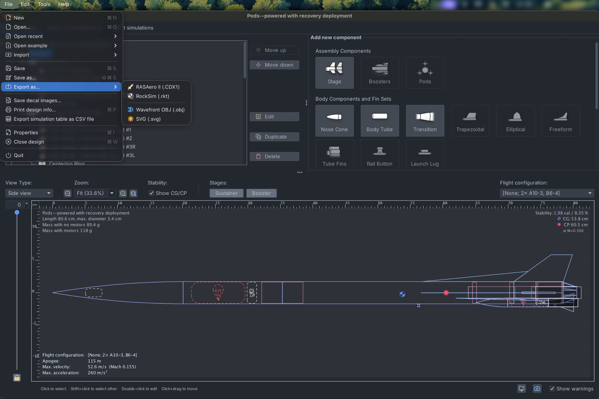
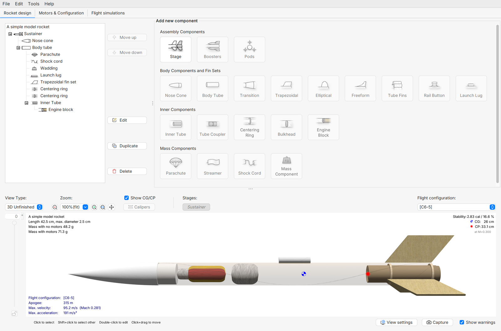

# OpenRocket: From Rocket Geometry to Flight Predictions

A motor choice changes more than predicted altitude. It also changes launch mass, balance, and the flight you need to recover. OpenRocket Simulator connects component design with trajectory analysis so you can compare those effects before building.

OpenRocket Software is free and open source. This guide follows a design through geometry checks, motor comparisons, and recovery planning, with links to the supplied project materials.

## Establish the Geometry and Balance

Build the model from nose cones, body tubes, fins, motor mounts, and recovery components. Match dimensions and materials to the rocket you intend to fly.

- Enter measured dimensions rather than relying only on a kit illustration.
- Account for hardware, adhesives, paint, and payload mass when refining the model.
- Compare the calculated center of gravity with the assembled vehicle.
- Revisit the balance after changing a motor or moving internal components.

The supplied [asimple.ork](test-writing/asimple.ork) contains a component-based design and several motor configurations. Use it to inspect how a design stores alternatives.

### Read the Stability Margin in Context

The center of gravity (CG) describes mass balance; the center of pressure (CP) describes the aerodynamic force location. Their separation, divided by a reference diameter, gives a static margin in calibers.

This independent Python calculation illustrates the arithmetic using example measurements in meters, with both positions measured aft from the nose:

```python
cg_m = 0.42
cp_m = 0.50
reference_diameter_m = 0.05
margin_calibers = (cp_m - cg_m) / reference_diameter_m
print(f"Static margin: {margin_calibers:.2f} calibers")
```

The result is 1.60 calibers. This calculation alone does not establish acceptable flight behavior; examine the modeled conditions and how stability changes through flight.

[](https://openrocket-simulator.github.io/OpenRocket-Software/)

## Compare Flights by Changing One Input

Use the openrocket model rocket simulator to keep a baseline design while comparing motor and launch-condition choices. A controlled comparison makes it easier to identify the cause of a changed prediction.

| Input varied | Keep fixed initially | Compare in the results |
| --- | --- | --- |
| Motor selection | Geometry and launch conditions | Apogee, velocity, acceleration, and balance |
| Launch mass | Motor and external geometry | Altitude and speed at launch-guide departure |
| Wind conditions | Rocket and motor configuration | Trajectory and recovery drift |
| Surface finish | Mass and motor | Drag-related changes in speed and altitude |
| Recovery timing | Powered-flight configuration | Deployment velocity and descent behavior |

OpenRocket supports six-degree-of-freedom simulation, staging, and motor clusters. Choose the configuration that represents the intended vehicle before interpreting any plot.

### Select Motors Against the Whole Flight

Search and filter the motor database for candidates that fit the model. Compare their thrust behavior and resulting trajectory instead of ranking candidates only by total impulse.

1. Preserve a baseline simulation with a clearly identified motor configuration.
2. Run alternatives under matching environmental conditions.
3. Inspect velocity and acceleration alongside the altitude curve.
4. Check the event sequence before accepting the highest predicted apogee.



Use the component analyzer to investigate aerodynamic contributions when a result changes unexpectedly. The openrocket rocket design software also provides optimization tools for exploring selected design goals.

An optimized result still depends on the mass, geometry, and environmental assumptions you supplied. Recheck those inputs before treating a numerical improvement as a build decision.

## Follow the Rocket Through Recovery

An openrocket flight simulation should include the descent you expect to observe, not just the powered climb.

### Separate the Events You Intend to Test

- Identify motor ignition, burnout, and any stage-separation events.
- Configure the recovery devices and deployment triggers.
- For dual deployment, review the drogue and main events separately.
- Inspect deployment velocity as well as deployment altitude.
- Compare landing behavior under more than one wind assumption.

Keep a note of which settings changed between runs. A recovery comparison becomes difficult to interpret if mass, motor, wind, and deployment timing all change together.

### Interpret Accuracy Through the Inputs

Replace estimated mass and balance with measurements as the build progresses. Record the launch conditions used for a simulation so that later flight comparisons have a meaningful baseline.

A close altitude prediction does not prove that every part of the trajectory is correct. Compare available measurements against the corresponding outputs rather than applying a single accuracy percentage to the entire model.



For the underlying aerodynamic and numerical methods, consult the [technical documentation](https://openrocket.info/documentation.html). Treat structural strength and construction quality as separate engineering questions.

## Keep Design Files Understandable

The supplied [apocd.ork](test-writing/apocd.ork) includes appearance information and mass overrides. The RockSim-format [apocdecals.rkt](test-writing/apocdecals.rkt) offers another document structure to inspect.

The notes in [fileformat.txt](fileformat.txt) distinguish the document format version from the application information recorded by its creator.

The following XML fragment illustrates a renamed rocket element using fields present in the supplied design. It is a fragment for understanding the format, not a complete runnable design:

```xml
<rocket>
  <name>Baseline motor comparison</name>
  <referencetype>maximum</referencetype>
</rocket>
```

Preserve a working design before experimenting with document contents. Opening and saving through the application is preferable to assuming that a short XML example captures the complete format.

### Choose an Export for Its Intended Use

OpenRocket can export designs to other simulation formats and component geometry to OBJ or SVG. Check which information the destination format preserves before using an exported file in another workflow.

Use geometry exports for the component representation they provide. Keep the original design as the reference for simulation configurations and subsequent comparisons.

## Trace the Supplied Project Materials

The build definition in [build.gradle](build.gradle) declares the desktop application entry point and build plugins. [gradle.properties](gradle.properties) records Gradle execution preferences.

The wrapper entry points are [gradlew](gradlew) for Unix-like shells and [gradlew.bat](gradlew.bat) for Windows. They work with [gradle-wrapper.jar](gradle/wrapper/gradle-wrapper.jar) and the distribution settings in [gradle-wrapper.properties](gradle/wrapper/gradle-wrapper.properties).

Platform-specific distribution handling is described in [distributions.gradle](gradle/distributions.gradle). The older [run.sh](run.sh) documents an Eclipse-oriented launch path and should be read in that context.

### Packaging and Desktop Integration

- [snapcraft.yaml](snap/snapcraft.yaml) defines the Snap package, application command, and interfaces.
- [launcher](snap/local/launcher) configures Java and environment settings inside the Snap runtime.
- [openrocket.desktop](snap/gui/openrocket.desktop) supplies Linux desktop-entry metadata.
- [openrocket.png](snap/gui/openrocket.png) is the desktop icon asset.

OpenRocket packages are available for Windows, macOS, and Linux. The official [package page](https://openrocket.info/downloads.html) explains that platform installers include the required Java runtime.

### Review and Attribution

The Java style configuration is [checkstyle.xml](config/checkstyle/checkstyle.xml); [excludeFilter.xml](config/spotbugs/excludeFilter.xml) records SpotBugs exclusions.

Read [CONTRIBUTING.md](CONTRIBUTING.md) for reporting and contribution practices, and [CODE_OF_CONDUCT.md](CODE_OF_CONDUCT.md) for community participation expectations.

[CITATION.cff](CITATION.cff) supplies citation metadata. [LICENSE.TXT](LICENSE.TXT) contains the supplied GNU GPL terms and additional packaging permission.

The supplied materials are a partial OpenRocket source snapshot: application source modules and the root settings file are absent. The build and packaging files describe upstream workflows, but this snapshot alone is insufficient to build the application.

## Related Search Terms

OpenRocket Simulator, OpenRocket Software, openrocket model rocket simulator, openrocket rocket design software, openrocket flight simulation, aerospace, flight-simulator, java, modeling, optimization, rocket, rocketry, simulation, trajectory, aerodynamics
